# POP'N UP

<div align="center">

### 팝업스토어 탐색부터 예약 · 결제 · QR 체크인까지 한 번에

**흩어져 있는 팝업스토어 정보를 한곳에서 탐색하고,  
예약부터 결제, QR 체크인까지 하나의 흐름으로 연결하는 팝업스토어 통합 플랫폼**

<br>


</div>

---

## 목차

- [프로젝트 소개](#프로젝트-소개)
- [팀원 및 역할](#팀원-및-역할)
- [주요 기능](#주요-기능)
- [기술 스택](#기술-스택)
- [서비스 플로우](#서비스-플로우)
- [시스템 아키텍처](#시스템-아키텍처)
- [ERD](#erd)
- [기술적 의사결정](#기술적-의사결정)
- [트러블 슈팅 & 성능 개선](#트러블-슈팅--성능-개선)
- [테스트](#테스트)
- [CI/CD & AWS](#cicd--aws)
- [모니터링](#모니터링)
- [프로젝트 성과](#프로젝트-성과)
- [프로젝트 구조](#프로젝트-구조)
- [향후 개선](#향후-개선)

---

## 프로젝트 소개

### 프로젝트 배경

팝업스토어 정보는 SNS, 블로그, 포털 검색, 지도, 공식 홈페이지 등 여러 채널에 분산되어 있습니다.

이 때문에 사용자는 원하는 팝업스토어를 찾기 위해 여러 플랫폼을 직접 확인해야 하며, 관심 있는 팝업의 위치와 운영 기간, 예약 일정 등을 한눈에 비교하기 어렵습니다.

POP'N UP은 이러한 문제를 해결하기 위해 **팝업스토어 탐색 → 예약 → 결제 → QR 체크인** 과정을 하나의 서비스로 연결했습니다.

### 핵심 목표

- 팝업스토어 정보 통합 탐색
- 스케줄 기반 예약 및 정원 관리
- KakaoPay 기반 결제
- QR 기반 현장 체크인
- JWT / OAuth2 기반 인증·인가
- 동시 예약 상황에서의 데이터 정합성 보장
- 부하 테스트를 통한 병목 식별 및 성능 개선
- AWS 기반 운영 환경 및 CI/CD 구축

---

## 팀원 및 역할

> 팀원별 담당 기능은 최종 담당 범위에 맞춰 작성합니다.

| 팀원 | 담당 기능 | 기술 고도화 |
| --- | --- | --- |
| 박지오 | 회원 / 인증 / 결제 / AWS 배포 | JWT Blacklist, 결제 동시성 검증, AWS CI/CD |
| 이명인 | 예약 / 스케줄 / QR 체크인 / 팝업 크롤링 / AWS 배포 | 인기 회차 동시 예약 처리, 같은 회원 중복 예약 방지, 과부하 제어, 예약 목록 조회 속도 향상, 일정 조회 속도 향상, 대량 예약 만료 처리 속도 향상, 중복 취소 방지, 남은 좌석 수 자동 보정, 장애 시 좌석 반환 누락 방지, 선착순 예약 대기열, AWS CI/CD |
| 팀원 3 |  |  |

---

## 주요 기능

### 회원 / 인증

- 회원가입 및 로그인
- JWT 기반 인증
- Kakao OAuth2 로그인
- 회원 정보 조회
- 비밀번호 변경
- 회원 탈퇴
- USER / ADMIN 권한 관리
- Redis JWT Blacklist 기반 로그아웃 토큰 재사용 방지

### 팝업스토어

- 팝업스토어 등록 / 조회 / 수정 / 삭제
- 팝업 카테고리 및 운영 상태 관리
- 팝업 이미지 관리
- Naver Geocoding 기반 주소 좌표 변환
- 지도 영역 기반 팝업 조회
- 사용자 위치 기반 주변 팝업 조회
- 팝업 데이터 크롤링

### 스케줄

- 팝업스토어별 예약 일정 생성
- 스케줄 일괄 등록
- 최대 정원 및 현재 예약 인원 관리
- 스케줄 조회

### 예약

- 스케줄 기반 예약 생성
- 예약 내역 조회
- 예약 취소
- 예약 상태 관리
- 동일 회원 중복 활성 예약 방지
- 동시 예약 정원 정합성 제어
- 결제 타임아웃 자동 처리
- 스케줄 종료 후 미방문 예약 처리

### 결제

- KakaoPay Ready API 연동
- KakaoPay Approve API 연동
- Payment 도메인 기반 결제 정보 관리
- PaymentStatus 기반 상태 관리
- 동일 예약 중복 결제 방지
- 동시 결제 요청 정합성 검증

### QR 체크인

- 결제 완료 예약 QR 발급
- 예약번호 기반 현장 체크인
- 중복 QR 체크인 방지
- 동시 체크인 정합성 검증

### 관리자

- 관리자 전용 API
- 회원 목록 조회
- 회원 상태 관리
- 관리자 예약 목록 조회
- 팝업 / 날짜 / 예약 상태 기반 조건 검색

---

## 기술 스택

### Backend

<p>
  
  
  
  
  
</p>

### Database & Cache

<p>
  
  
  
</p>

### Authentication & External API

- Spring Security
- JWT
- Kakao OAuth2
- KakaoPay
- Naver Geocoding
- ZXing

### Test & Performance

- JUnit 5
- MockMvc
- Testcontainers
- k6
- Spring Boot Actuator

### Infra & CI/CD

<p>
  
  
  
</p>

---

## 서비스 플로우

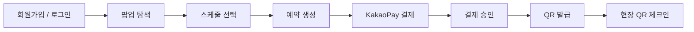

---

## 시스템 아키텍처

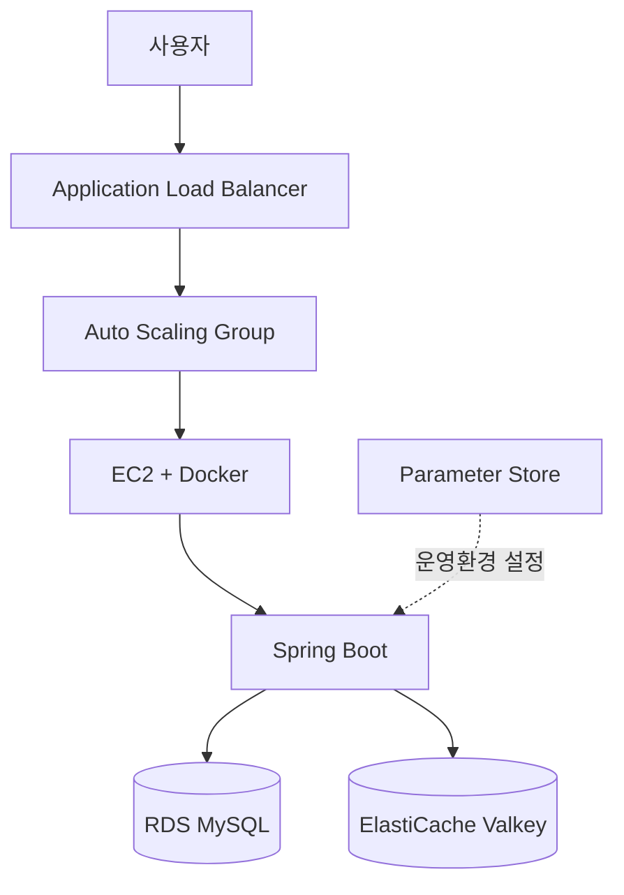

### AWS 네트워크 구성

- POP'N UP 전용 VPC
- Public / Private Subnet 구성
- NAT Gateway 구성
- Security Group 기반 접근 제어
- ALB → EC2
- EC2 → RDS MySQL
- EC2 → ElastiCache Valkey

---

## ERD

> ERD 이미지 추가 예정

주요 도메인은 다음과 같이 구성했습니다.

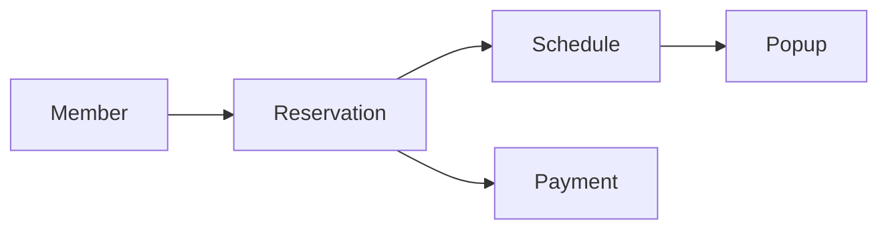

---

# 기술적 의사결정

## 1. Layered Architecture

### 선택 이유

HTTP 요청 처리, 비즈니스 로직, 데이터 접근의 책임을 분리하기 위해 `Controller → Service → Repository` 기반 계층형 구조를 사용했습니다.

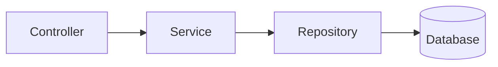

- **Controller**: HTTP 요청 및 응답 처리
- **Service**: 비즈니스 정책 및 트랜잭션 처리
- **Repository**: 데이터 접근

각 도메인을 중심으로 관련 Controller, Service, Repository, Entity, DTO를 분리하여 기능별 책임을 구분했습니다.

---

## 2. Spring Security + JWT

### 선택 이유

서버가 사용자별 세션을 관리하지 않는 Stateless 인증 구조를 구성하기 위해 JWT를 적용했습니다.

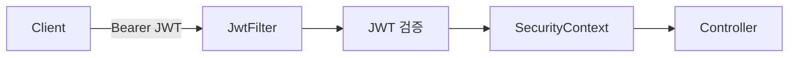

일반 사용자와 관리자는 `ROLE_USER`, `ROLE_ADMIN`으로 구분하여 API 접근 권한을 제어했습니다.

Kakao OAuth2 로그인 역시 로그인 성공 후 서비스 JWT를 발급하여 동일한 인증 체계를 사용하도록 구성했습니다.

---

## 3. Redis JWT Blacklist

### 문제

JWT는 Stateless 방식이므로 로그아웃 이후에도 토큰의 유효기간이 남아 있다면 기존 Access Token을 다시 사용할 수 있습니다.

### 적용

로그아웃된 JWT를 Redis Blacklist에 저장하고 인증 과정에서 Blacklist 등록 여부를 검사하도록 구성했습니다.

Blacklist 데이터는 JWT의 남은 유효시간을 기준으로 관리하여 만료 이후 자동으로 제거되도록 했습니다.

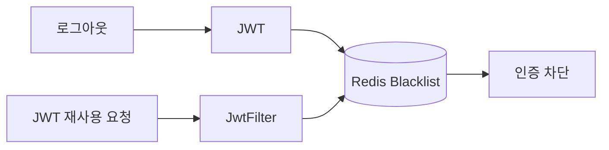

---

## 4. QueryDSL

### 선택 이유

관리자 예약 조회에서 팝업, 날짜, 예약 상태 등 여러 검색 조건을 동적으로 조합할 필요가 있었습니다.

QueryDSL의 `BooleanExpression`을 이용하여 필요한 조건만 동적으로 조합하고, Fetch Join을 이용하여 예약 조회에 필요한 연관 데이터를 함께 조회하도록 구성했습니다.

### 적용 영역

- 팝업 ID 조건
- 날짜 조건
- 예약 상태 조건
- Reservation / Member / Schedule / Popup 연관 조회

---

# 트러블 슈팅 & 성능 개선

## 1. 과부하 구간 및 HikariCP 병목 분석

### 문제 원인

Conditional UPDATE 적용 이후에도 시스템이 실제로 어느 수준의 요청까지 안정적으로 처리할 수 있는지는 확인되지 않았습니다.

또한 기존 RateLimiter는 다음과 같이 설정되어 있어 실제 처리 한계보다 지나치게 높은 상태였습니다.

```yaml
limitForPeriod: 200000
limitRefreshPeriod: 1s
```

실제 부하 테스트에서 `429` 응답이 발생하지 않아 과부하 보호 역할을 수행하지 못하고 있음을 확인했습니다.

### 측정 방법

k6의 `ramping-arrival-rate`를 이용하여 예약 생성 요청을 **50 req/s → 1,000 req/s**까지 단계적으로 증가시켰습니다.

동시에 다음 지표를 관찰했습니다.

- HTTP 응답시간
- p99
- Dropped Iterations
- Docker CPU / Memory
- HikariCP Connection

### 측정 결과

#### Container Resource

| Container | CPU | Memory |
| --- | ---: | ---: |
| Spring Boot | 53.99% | 8.62% |
| MySQL | 23.68% | 6.50% |

#### HikariCP

| 지표 | 값 |
| --- | ---: |
| `connections.max` | 50 |
| `connections.active` | **50 / 50** |
| Connection 사용률 | **100%** |

#### HTTP

| 지표 | 결과 |
| --- | ---: |
| 안정 처리량 | 약 **800 req/s** |
| 포화 시작 | 약 **800 ~ 900 req/s** |
| 평균 응답시간 | 약 776ms → 병목 진입 시 약 13초 |
| p99 | 약 **25.8초** |
| Dropped Iterations | 약 **70%** |

### Connection Pool 추가 검증

CPU와 Memory는 병목 구간에서도 여유가 있었지만 HikariCP는 `50 / 50`으로 포화되었습니다.

Connection Pool과 포화 시점 사이의 관계를 추가로 확인하기 위해 `maximum-pool-size`를 변경하여 다시 측정했습니다.

| HikariCP Maximum Pool Size | 포화 시작 |
| ---: | ---: |
| 50 | 약 900 req/s |
| 20 | 약 290 req/s |

### 결과

> **해당 테스트 환경의 주요 병목이 CPU나 Memory가 아니라 DB Connection Pool임을 확인했습니다.**

Pool Size를 `50 → 20`으로 줄였을 때 포화 시점 역시 약 `900 → 290 req/s`로 앞당겨지는 것을 확인했습니다.

---

## 2. 중복 결제 방지

### 문제 원인

동일 Reservation에 두 개의 결제 생성 요청이 동시에 발생하면 애플리케이션에서 Payment 존재 여부를 먼저 검사하더라도 두 요청이 동시에 검증을 통과할 가능성이 있습니다.

### 개선

애플리케이션 사전 검증과 DB UNIQUE Constraint를 함께 사용했습니다.

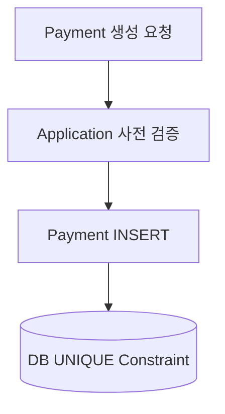

Reservation과 Payment 관계에서 `reservation_id`에 UNIQUE 제약을 적용하여 동일 예약에 여러 Payment가 생성되지 않도록 했습니다.

### 동시성 테스트

동일 Reservation에 대해 두 개의 독립적인 요청을 동시에 실행했습니다.

| 항목 | 결과 |
| --- | ---: |
| 동시 요청 | 2건 |
| 성공 | **1건** |
| 실패 | **1건** |
| 최종 Payment | **1건** |

### 결과

> **애플리케이션 사전 검증과 DB UNIQUE Constraint를 함께 적용하여 동시 요청에서도 하나의 Payment만 생성되는 것을 검증했습니다.**

---

## 3. 결제 승인 ↔ 예약 만료 Race Condition

### 문제 원인

결제 승인과 예약 만료가 거의 동시에 실행되면 두 로직이 동일한 Reservation 상태를 변경하려는 Race Condition이 발생할 수 있습니다.

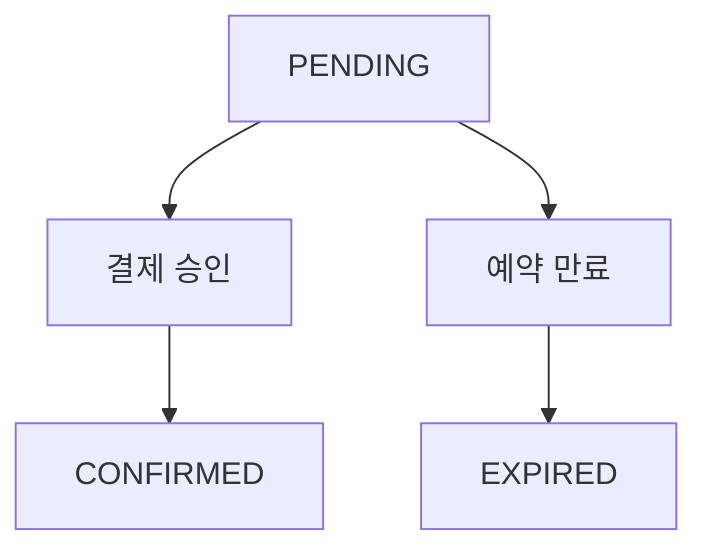

### 검증

결제 승인과 예약 만료를 독립적인 트랜잭션으로 동시에 실행하여 상태 경쟁 상황을 재현했습니다.

### 결과

만료 처리가 먼저 완료된 경우 Reservation은 `PENDING → EXPIRED`로 전이되며, 이후 결제 승인 요청은 실패하도록 처리했습니다.

좌석 역시 한 번만 복구되는 것을 확인했습니다.

> 이를 통해 **동시 실행을 직렬화하는 것과 올바른 비즈니스 상태를 결정하는 것은 별개의 문제**라는 점을 확인했습니다.

---

## 4. AWS 배포 후 Redis Health Check 장애

### 문제 상황

AWS 배포 이후 Spring Boot는 실행되었지만 Actuator Health Check가 다음과 같이 나타났습니다.

```json
{
  "status": "DOWN"
}
```

HTTP 응답 역시 `503` 상태였습니다.

### 원인

운영 환경에서 Redis Host가 `localhost:6379`를 바라보고 있어 Redis Health Check가 실패하고 있었습니다.

### 해결

ElastiCache Valkey를 구성하고 Security Group과 Parameter Store의 `REDIS_HOST`, `application-prod.yaml`을 연결했습니다.

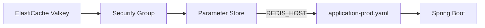

### 결과

```json
{
  "status": "UP"
}
```

Actuator Health Check가 정상화되었고 ALB Target 역시 **Healthy** 상태로 전환되었습니다.

이후 Instance Refresh 배포가 정상적으로 완료되는 것을 확인했습니다.

---

## 5. 과부하 제어 (로컬 세마포어)

**문제 원인**
- 부하를 올려 보면 병목은 CPU · 메모리가 아니라 DB 커넥션 풀이었습니다 (포화 구간에서 앱 CPU 약 54%, MySQL CPU 약 24%, HikariCP 커넥션 50 / 50 사용 중).
- 유입이 처리 능력을 넘으면 커넥션을 기다리는 요청이 계속 쌓여, 이미 받아 준 요청까지 느려집니다.
- 기존 RateLimiter는 초당 200,000건으로 설정되어 있어 과부하 보호 역할을 하지 못했습니다.

**기술 교체**
- **로컬 세마포어 (동시 처리 한도 40):** 예약 트랜잭션 구간의 동시 실행 수를 커넥션 풀(50)보다 작게 묶어 풀 고갈을 막습니다.
- **짧은 대기 후 거절:** 자리가 없으면 잠깐만 기다리고, 그 이상은 `503 + Retry-After`로 바로 거절합니다. `Retry-After`는 1~3초 중 무작위라 거절된 요청이 한 순간에 다시 몰리지 않습니다.
- **매진 확인을 세마포어 앞에:** 매진된 뒤 요청은 자리를 차지하지 않고 바로 거절합니다.

**전후 비교**

테스트 시나리오: 정원이 100명인 회차에 1만 명이 동시에 예약 요청

| 구분 | 표본 수 | p95 (ms) | p99 (ms) | 오류 % | 초당 요청 수 | 초당 처리한 요청 수 | 초당 처리한 트랜잭션 수 | 정원 초과 건수 |
|---|---:|---:|---:|---:|---:|---:|---:|---:|
| 도입 전 | 10,000 | 3,095.9 | 3,130.8 | 0.00 | 2,159.8 | 2,159.8 | 21.6 | 0 |
| 도입 후 | 10,000 | 1,719.0 | 1,734.0 | 0.00 | 3,598.8 | 2,967.6 | 36.0 | 0 |


**성능 개선 요약**
- **응답 시간:** p95 3,095.9 ms → 1,719.0 ms (44.5% 단축, 1.80배 빠름), p99 3,130.8 ms → 1,734.0 ms (44.6% 단축, 1.81배 빠름)
- **처리량:** 초당 처리한 요청 2,159.8건 → 2,967.6건 (37.4% 증가, 1.37배), 초당 처리한 트랜잭션 21.6건 → 36.0건 (66.7% 증가, 1.67배)
- **정합성:** 정원 초과 둘 다 0건

---

## 6. 인기 회차 예약 경합 처리 (Redis Lua 좌석 선점)

**문제 원인**
- 기존 코드는 회차 행을 `SELECT ... FOR UPDATE`로 잠근 뒤 정원을 늘려, 인기 회차 하나에 몰린 요청이 모두 그 한 행의 락에 줄을 섰습니다.
- 좌석이 다 팔린 뒤의 거절 응답까지 줄을 서서 느려지고, 요청마다 DB 트랜잭션 · 커넥션을 붙잡았습니다.
- 같은 회원이 동시에 두 번 요청하면 둘 다 중복 확인을 통과해, 정원 100석 중 11석이 같은 회원의 중복 예약이었습니다.

**기술 교체**
- **Redis Lua 좌석 선점:** '남은 좌석 확인 + 차감'을 Redis 안에서 한 번에 원자적으로 실행해 락 대기를 없앴습니다.
- **같은 회원 확인:** 같은 스크립트에서 같은 회원의 진행 중 예약을 함께 확인해, 중복 요청은 좌석을 잡지 않고 바로 거절합니다 (Redis 호출 수는 그대로).
- **DB 조건부 UPDATE (최종 방어선):** `now_capacity + :count <= max_capacity` 조건으로 정원 초과를 막습니다.
- **정원 마감 선확인:** 매진된 뒤 요청은 트랜잭션을 열기 전에 Redis에서 바로 거절합니다.

**전후 비교**

테스트 시나리오: 서로 다른 회원 200명이 정원이 100명인 회차에 동시에 예약 요청, 그중 50명은 같은 요청을 한 번 더 보냄 (총 250건)

| 구분 | 표본 수 | p95 (ms) | p99 (ms) | 오류 % | 초당 요청 수 | 초당 처리한 요청 수 | 초당 처리한 트랜잭션 수 | 정원 초과 건수 | 중복 예약 건수 |
|---|---:|---:|---:|---:|---:|---:|---:|---:|---:|
| 도입 전 | 250 | 1,569.5 | 1,593.1 | 0.00 | 154.2 | 154.2 | 61.7 | 0 | 11 |
| 도입 후 | 250 | 959.0 | 1,020.4 | 0.00 | 240.5 | 240.5 | 96.2 | 0 | 0 |


**성능 개선 요약**
- **응답 시간:** p95 1,569.5 ms → 959.0 ms (38.9% 단축, 1.64배 빠름), p99 1,593.1 ms → 1,020.4 ms (35.9% 단축, 1.56배 빠름)
- **처리량:** 초당 처리한 요청 154.2건 → 240.5건 (56.0% 증가, 1.56배), 초당 처리한 트랜잭션 61.7건 → 96.2건 (55.9% 증가)
- **정합성:** 중복 예약 11건 → 0건, 정원 초과는 둘 다 0건. 정원 100석은 둘 다 모두 참

---

## 7. 대용량 목록 조회 성능 개선 (페이지네이션, 정렬 키 복합 인덱스, 커서 페이지네이션)

**문제 원인**
- 기존 코드는 페이징 없이 조건에 맞는 예약을 전부 돌려줘, 예약 10만 건이 몰린 날짜는 응답 하나가 약 24.9 MB였습니다.
- 조회 조건(팝업)과 정렬 키(회차 날짜 · 시작 시각)가 회차 테이블에 있어 두 테이블에 걸친 정렬이 되었고, 인덱스로 정렬하지 못해 조건에 맞는 행을 모두 읽은 뒤 `filesort`했습니다.
- OFFSET 페이징은 깊은 페이지일수록 앞의 행을 모두 읽고 버려 느려집니다.

**기술 교체**
- **페이지네이션 + 조인 제거:** 전체 반환 대신 20건씩 돌려줍니다.
- **정렬 키 복제 + 복합 인덱스:** 회차의 `popup_id`, `schedule_date`, `start_time`을 예약 행에 복제하고 `(popup_id, schedule_date, start_time, id)` 인덱스로 `filesort` 없이 20건만 읽고 멈춥니다.
- **커서(키셋) 페이지네이션:** 직전 페이지 마지막 행의 `(schedule_date, start_time, id)` 다음부터 읽어, 깊은 페이지도 첫 페이지와 같은 비용으로 조회합니다. 응답의 `nextCursor`를 다음 요청에 그대로 씁니다.

**전후 비교**

**① 페이지네이션 + 조인 제거**

테스트 시나리오: 예약 10만 건이 몰린 팝업의 특정 날짜 목록을 관리자 5명이 동시에 반복 조회 (전체 예약 100만 건)

| 구분 | 표본 수 | p95 (ms) | p99 (ms) | 오류 % | 초당 처리한 요청 수 | 요청당 SQL 수 | 요청당 DB 실행 시간 (ms) | 스캔 행 수 | 응답 크기 (KB) |
|---|---:|---:|---:|---:|---:|---:|---:|---:|---:|
| 도입 전 | 230 | 2,905.6 | 3,151.3 | 0.00 | 1.9 | 1 | 542.26 | 300,010 | 24,919.9 |
| 도입 후 | 864 | 784.2 | 809.6 | 0.00 | 7.2 | 1 | 335.78 | 200,030 | 5.0 |


**② 정렬 기준 복합 인덱스**

테스트 시나리오: 예약 10만 건이 몰린 팝업의 특정 날짜 목록을 관리자 5명이 동시에 반복 조회 (전체 예약 100만 건)

| 구분 | 표본 수 | p95 (ms) | p99 (ms) | 오류 % | 초당 처리한 요청 수 | 스캔 행 수 | DB 실행 시간 (ms) |
|---|---:|---:|---:|---:|---:|---:|---:|
| 도입 전 | 864 | 784.2 | 809.6 | 0.00 | 7.2 | 200,030 | 335.78 |
| 도입 후 | 178,689 | 3.8 | 4.5 | 0.00 | 1,489.2 | 80 | 1.04 |


**③ 커서 페이지네이션**

테스트 시나리오: 예약 10만 건이 몰린 팝업의 특정 날짜 목록 전체를 1쪽부터 5,000쪽까지 차례로 조회

| 구분 | 앞쪽 응답 p95 (1~100쪽, ms) | 뒤쪽 응답 p95 (4,901~5,000쪽, ms) | 깊이에 따른 증가 (뒤쪽 ÷ 앞쪽, 배) | 5,000쪽 전체 탐색 시간 (초) |
|---|---:|---:|---:|---:|
| 도입 전 | 5.9 | 228.4 | 38.7 | 508.2 |
| 도입 후 | 4.0 | 2.3 | 0.6 | 12.9 |


**성능 개선 요약**
- **① 페이지네이션 + 조인 제거**
    - **응답 시간:** p95 2,905.6 ms → 784.2 ms (73.0% 단축, 3.71배 빠름), p99 3,151.3 ms → 809.6 ms (74.3% 단축, 3.89배 빠름)
    - **처리량:** 초당 처리한 요청 1.9건 → 7.2건 (3.79배)
    - **응답 크기:** 24,919.9 KB → 5.0 KB (10만 건 전체 → 20건). DB 실행 시간은 542.26 ms → 335.78 ms로 38.1%만 줄어 정렬 비용이 남음 (②에서 해결)
- **② 정렬 기준 복합 인덱스**
    - **응답 시간:** p95 784.2 ms → 3.8 ms (99.5% 단축, 206배 빠름), p99 809.6 ms → 4.5 ms (99.4% 단축, 180배 빠름)
    - **처리량:** 초당 처리한 요청 7.2건 → 1,489.2건 (207배)
    - **DB:** 스캔 행 200,030 → 80, DB 실행 시간 335.78 ms → 1.04 ms (99.7% 단축)
- **③ 커서 페이지네이션**
    - **뒤쪽 응답 p95:** 228.4 ms → 2.3 ms (99.0% 단축, 99배 빠름)
    - **깊이에 따른 증가:** 38.7배 → 0.6배 (커서는 쪽 번호와 상관없이 일정)
    - **5,000쪽 전체 탐색:** 508.2초 → 12.9초 (97.5% 단축, 39배 빠름)

---

## 8. 일정 목록 조회 캐시 (Redis 캐시 + 논리 만료)

**문제 원인**
- 같은 팝업 · 날짜의 일정 목록을 초당 2,000건 조회하면 같은 SQL이 초당 약 2,000번 DB로 갑니다.
- 캐시를 넣어도 만료되는 순간 기다리던 요청이 한꺼번에 DB로 몰립니다 (Cache Stampede).

**기술 교체**
- **Redis 캐시 (3초):** 값과 갱신 시각을 함께 저장하고, Redis 키의 TTL은 그 2배로 둡니다.
- **논리 만료:** 갱신 시각이 지나면 락을 잡은 1건만 DB에서 갱신하고, 나머지 요청은 기다리지 않고 기존 값을 바로 돌려줍니다.
- **키가 없을 때:** 1건만 DB를 읽어 캐시를 채우고, 나머지는 최대 50 ms 동안 2 ms 간격으로 캐시를 다시 보며 기다립니다.

**전후 비교**

테스트 시나리오: 같은 팝업 · 날짜의 일정 목록을 초당 2,000건 조회 (캐시 3초)

| 구분 | 표본 수 | p95 (ms) | p99 (ms) | 오류 % | 초당 처리한 요청 수 | 적중 응답 p99 (ms) | 미적중 응답 p99 (ms) | 만료 직후 1초 DB 조회 수 |
|---|---:|---:|---:|---:|---:|---:|---:|---:|
| 캐시 없음 | 240,001 | 4.3 | 8.4 | 0.00 | 2,000.1 | — | 8.4 | 2,016 |
| 캐시 + 동시 재생성 제어 | 240,001 | 1.6 | 3.5 | 0.00 | 2,000.1 | 1.0 | 11.2 | 1 |


**성능 개선 요약**
- **응답 시간:** p95 4.3 ms → 1.6 ms (62.8% 단축, 2.69배 빠름), p99 8.4 ms → 3.5 ms (58.3% 단축, 2.40배 빠름)
- **DB 부하:** 만료 직후 1초 DB 조회 2,016건 → 1건
- **처리량:** 둘 다 초당 2,000건, 오류 0건

---

## 9. 대량 예약 만료 처리 (청크 단위 트랜잭션 · SKIP LOCKED 다중 워커)

**문제 원인**
- 기존 코드는 만료 대상을 한 번에 모두 메모리로 읽은 뒤(스캔 970,916행), 예약마다 트랜잭션을 열어 예약 · 회차 행을 잠그고 하나씩 처리했습니다.
- 대상을 청크로 나눠 읽어도 처리 시간은 줄지 않았습니다. 시간은 읽기가 아니라 예약마다 트랜잭션을 열고 회차 행을 잠그는 데 쓰였습니다.
- 워커 하나가 청크를 차례로 처리해, 대상이 많을 때 여러 워커가 나눠 처리할 수 없었습니다.

**기술 교체**
- **청크 단위 트랜잭션:** 청크 100건마다 트랜잭션 하나로 잠금 → 일괄 만료 → 회차별 좌석 일괄 반환을 합니다. 청크가 실패하면 그 청크만 되돌리고 건별로 다시 처리합니다.
- **청크 크기 100:** 사전 측정에서 100 · 500 · 1,000 중 가장 빠르고 락을 가장 짧게 쥡니다 (처리 시간 12.7 · 16.1 · 21.1초, 트랜잭션 최대 90 · 444 · 1,113 ms).
- **`FOR UPDATE SKIP LOCKED` 다중 워커:** 다른 워커가 잠근 행은 기다리지 않고 건너뛰어, 워커들이 남은 청크를 중복 없이 나눠 처리합니다. READ COMMITTED와 회차 id 순 잠금으로 교착 상태를 막았습니다.

**전후 비교**

**① 청크 처리 · 청크 단위 트랜잭션**

테스트 시나리오: 전체 예약 100만 건 중 만료된 예약 2만 건을 처리, 처리하는 동안 만료 대상과 같은 회차에 예약 요청 초당 400건. 만료 대상을 여러 회차 분산 / 한 인기 회차 집중으로 놓고 각각 측정 (집중은 정원 10만인 회차 하나에 몰아 부하를 키운 조건). 도입 후의 청크 크기는 100 · 500 · 1,000 중 사전 측정으로 고른 값

**여러 회차 분산**

| 단계 | 처리 시간 (초) | 초당 처리 건수 | 스캔 행 수 | 앱 메모리 최대 (MB) | 락 보유 시간 최대 (ms) | 배치 전 예약 API p99 (ms) | 배치 중 예약 API p99 (ms) | 처리 시간 단축률 (도입 전 대비) |
|---|---:|---:|---:|---:|---:|---:|---:|---:|
| 도입 전 | 446.2 | 45 | 970,916 | 1,353 | 243.3 | 35.5 | 34.2 | — |
| 도입 후 | 17.7 | 1,128 | 20,000 | 1,731 | 255.8 | 34.7 | 89.0 | 96.0% |

**한 인기 회차 집중** (스캔 행 수 · 앱 메모리는 분산과 같아 뺌)

| 단계 | 처리 시간 (초) | 초당 처리 건수 | 락 보유 시간 최대 (ms) | 배치 전 예약 API p99 (ms) | 배치 중 예약 API p99 (ms) | 처리 시간 단축률 (도입 전 대비) |
|---|---:|---:|---:|---:|---:|---:|
| 도입 전 | 876.0 | 23 | 4,058.2 | 27,685.8 | 28,342.3 | — |
| 도입 후 | 72.5 | 276 | 647.6 | 473.6 | 487.3 | 91.7% |


**② 다중 워커**

테스트 시나리오: 만료된 예약 10만 건을 워커 1 · 2 · 4개가 나눠 처리. 만료 대상을 여러 회차 분산 / 한 인기 회차 집중으로 놓고 각각 측정

**여러 회차 분산**

| 워커 수 | 처리 시간 (초) | 초당 처리 건수 | 중복 처리 건수 |
|---|---:|---:|---:|
| 1 (도입 전) | 66.8 | 1,496 | 0 |
| 2 | 30.7 | 3,263 | 0 |
| 4 | 19.1 | 5,249 | 0 |

**한 인기 회차 집중**

| 워커 수 | 처리 시간 (초) | 초당 처리 건수 | 중복 처리 건수 |
|---|---:|---:|---:|
| 1 (도입 전) | 8.8 | 11,339 | 0 |
| 2 | 5.9 | 17,007 | 0 |
| 4 | 6.0 | 16,728 | 0 |


**③ 장애 후 재처리**

테스트 시나리오: 여러 회차에 분산된 만료 예약 10만 건을 처리하는 도중 앱을 강제 종료하고 다시 켬 (결제 만료 스케줄러 5초 주기)

| 구분 | 복구 시간 (재기동 후 미처리 0건까지, 초) | 만료 누락 | 좌석 중복 반환 |
|---|---:|---:|---:|
| 도입 전 | 435.2 | 0 | 0 |
| 도입 후 | 17.6 | 0 | 0 |


**성능 개선 요약**
- **① 청크 처리 · 청크 단위 트랜잭션**
    - **처리 시간:** 분산 446.2초 → 17.7초 (96.0% 단축, 25.2배 빠름), 집중 876.0초 → 72.5초 (91.7% 단축, 12.1배 빠름)
    - **처리량:** 초당 처리 건수 분산 45건 → 1,128건, 집중 23건 → 276건
    - **스캔 행:** 970,916 → 20,000 (만료 대상만 읽음). 집중의 락 보유 시간 최대 4,058.2 ms → 647.6 ms (84.0% 단축)
    - 배치 중 예약 API p99는 분산에서 34.2 ms → 89.0 ms로 늘어남
- **② 다중 워커**
    - **분산:** 워커 1 → 2 → 4에서 처리 시간 66.8초 → 30.7초 → 19.1초 (워커 4에서 71.4% 단축, 3.50배 빠름)
    - **집중:** 8.8초 → 5.9초 → 6.0초 (워커 2에서 33.0% 단축, 워커 4는 2와 같음)
    - **정합성:** 모든 경우 중복 처리 0건
- **③ 장애 후 재처리**
    - **복구 시간:** 435.2초 → 17.6초 (96.0% 단축, 24.7배 빠름)
    - **정합성:** 만료 누락 · 좌석 중복 반환 둘 다 0건

---

## 10. 예약 정합성 — 멱등성과 장애 복구 (상태 조건 UPDATE · 정원 재동기화 · Transactional Outbox)

**문제 원인**
- 기존 코드는 잠그기 전에 읽어 둔 상태로 취소 여부를 판단해, 같은 예약에 취소 10건이 동시에 들어오자 이미 취소된 예약의 좌석을 847번 더 돌려줬습니다.
- 결제 확정과 만료 배치가 같은 결제 대기 예약을 동시에 처리하면, 확정된 예약의 좌석이 반환될 수 있었습니다.
- 정원이 Redis와 DB 두 곳에 있어, 앱이 죽거나 Redis 데이터가 사라지면 두 값이 어긋난 채 남았습니다.
- 좌석 반환을 커밋 직후 Redis에 바로 반영해, Redis 연결이 끊긴 동안의 반환이 사라졌습니다.

**기술 교체**
- **상태 조건 UPDATE:** `UPDATE ... WHERE id = :id AND status IN (:from)` 한 문장으로 확인과 변경을 함께 해, 같은 요청이 동시에 몇 번 와도 한 번만 성공합니다. 이미 처리된 재요청은 좌석을 건드리지 않고 성공 응답을 돌려줍니다.
- **확정 · 만료 경쟁:** 만료 배치는 `SKIP LOCKED`로 확정이 잠근 예약을 건너뛰고, 만료 UPDATE는 `status = 'PENDING'` 조건이라 먼저 확정된 예약은 바뀌지 않습니다.
- **정원 재동기화 (1분 주기):** DB와 Redis의 회차 정원을 비교해, 다음 주기에도 같은 차이가 보이면 DB 값으로 고칩니다.
- **Transactional Outbox:** 좌석 반환 이벤트를 좌석을 돌려준 트랜잭션 안에 저장하고, 커밋 직후 반영과 0.2초 주기 중계기가 Redis에 반영합니다. 이벤트마다 적용 표시를 남겨 두 번 반영되지 않습니다.

**전후 비교**

**① 예약 상태 전이 멱등성**

테스트 시나리오: 확정된 예약 1,000건마다 같은 취소 요청을 10건씩, 다른 확정 예약 1,000건마다 같은 체크인 요청을 10건씩 동시에 보냄

| 구분 | 표본 수 | p95 (ms) | p99 (ms) | 오류 % | 좌석 중복 반환 건수 (취소) | 중복 체크인 성공 건수 (체크인) | 미복구 불일치 건수 |
|---|---:|---:|---:|---:|---:|---:|---:|
| 도입 전 | 20,000 | 1,542.0 | 3,103.7 | 0.00 | 847 | 0 | 847 |
| 도입 후 | 20,000 | 277.7 | 394.2 | 0.00 | 0 | 0 | 0 |


**② 결제 확정과 만료의 경쟁**

테스트 시나리오: 결제 대기 예약 1,000건에 결제 확정과 만료를 같은 순간에 실행 (확정은 결제 승인 뒤의 예약 확정 단계)

| 구분 | 경쟁 건수 | 확정으로 끝남 | 만료로 끝남 | 상태 · 좌석 불일치 건수 | 확정 처리 p99 (ms) |
|---|---:|---:|---:|---:|---:|
| 도입 전 | 1,000 | 1,000 | 0 | 0 | 27.1 |
| 도입 후 | 1,000 | 8 | 992 | 0 | 13.7 |


**③ 장애 후 정원 대사**

테스트 시나리오: 예약 요청 초당 400건이 걸린 중에 장애를 일으키고, 장애가 끝난 뒤 4분 동안 Redis 정원과 DB 정원이 같아지는지 관찰 (재동기화는 운영 주기 1분)

| 장애 | 장애 직후 불일치 회차 수 (도입 전 / 도입 후) | 도입 전 (재동기화 없음) 4분 뒤 불일치 회차 수 | 도입 후 (재동기화) 복구 시간 (초) | 도입 후 4분 뒤 불일치 회차 수 |
|---|---:|---:|---:|---:|
| 앱 강제 종료 | 2 / 14 | 0 | 96.3 | 0 |
| Redis 데이터 유실 | 100,017 / 100,017 | 100,017 | 175.3 | 0 |
| Redis 강제 종료 후 재시작 | 11,939 / 12,016 | 11,939 | 114.1 | 0 |


**④ 좌석 반환 Outbox**

테스트 시나리오: 회차 10개(정원 100)의 확정 예약 1,000건을 섞어 초당 50건씩 취소하는 동안(20초), 시작 5초 뒤 Redis 연결을 약 12초 끊었다가(컨테이너 정지, 저장 후 종료라 값은 그대로) 다시 연결. 정원 재동기화는 꺼서 반환 경로만 봄

그래프: Redis 연결이 끊긴 동안 쌓였다가 재연결 뒤 줄어드는 미처리 이벤트 수(도입 후), Redis와 DB가 어긋난 좌석 수(도입 전 · 도입 후)

| 구분 | 취소 요청 | 미처리 이벤트 최대 | 전달 지연 p99 (정상 구간 / 끊긴 동안 생긴 이벤트) | 복구 시간 (재연결 뒤, 초) | 중복 효과 (두 번 반영된 좌석) | 미복구 불일치 (사라진 좌석 반환) | 취소 응답 p95 / p99 (ms) | 오류 % |
|---|---:|---:|---:|---:|---:|---:|---:|---:|
| 도입 전 | 1,000 | — | — | 복구 안 됨 | 0 | 350석 (회차 5개) | 4,613.2 / 4,733.2 | 0.00 |
| 도입 후 | 1,000 | 593 | 25.0 ms / 11,658.3 ms | 0.28 | 0 | 0 | 31.8 / 110.9 | 0.00 |


**성능 개선 요약**
- **① 예약 상태 전이 멱등성**
    - **응답 시간:** p95 1,542.0 ms → 277.7 ms (82.0% 단축, 5.55배 빠름), p99 3,103.7 ms → 394.2 ms (87.3% 단축, 7.87배 빠름)
    - **정합성:** 좌석 중복 반환 847건 → 0건, 미복구 불일치 847건 → 0건. 중복 체크인은 둘 다 0건
- **② 결제 확정과 만료의 경쟁**
    - **정합성:** 상태 · 좌석 불일치 둘 다 0건 (한 예약은 확정 · 만료 중 한쪽으로만 끝남. 어느 쪽이 이기는지는 처리 순서에 따라 달라짐)
    - **확정 처리 p99:** 27.1 ms → 13.7 ms (49.4% 단축, 1.98배 빠름)
- **③ 장애 후 정원 대사**
    - **Redis 데이터 유실:** 4분 뒤 불일치 회차 100,017개 → 0개 (175.3초에 복구)
    - **Redis 강제 종료 후 재시작:** 4분 뒤 불일치 회차 11,939개 → 0개 (114.1초에 복구)
    - **앱 강제 종료:** 어긋난 회차가 2 · 14개로 적고, 도입 후는 96.3초에 0개. 도입 전도 관찰 끝 무렵 0개
- **④ 좌석 반환 Outbox**
    - **정합성:** Redis가 끊긴 동안 사라진 좌석 반환 350석 → 0석. 재연결 0.28초 뒤 쌓인 이벤트 593건을 모두 반영, 중복 반영 0건
    - **취소 응답:** p95 4,613.2 ms → 31.8 ms (99.3% 단축), p99 4,733.2 ms → 110.9 ms (97.7% 단축)
    - **전달 지연:** 정상 구간 p99 25.0 ms

---

## 11. 예약 대기열 · 입장량 제어 (Redis 대기열, 진입 때 확정)

**문제 원인**
- 대기열 없이 1만 명이 한 회차에 몰리면 요청의 94.53%가 과부하 거절(503)되고 초당 188.5건만 처리됩니다.
- 정원이 적은 회차에서는 거절된 요청이 다시 시도하며 경쟁해, 먼저 신청한 사람이 아니라 먼저 다시 온 사람이 좌석을 가져갑니다.
- 입장 토큰 방식 대기열도 입장한 회원끼리 다시 예약을 경쟁해 순서가 지켜지지 않았습니다.

**기술 교체**
- **진입 = 예약 신청:** 대기 번호를 발급하는 Lua 안에서 바로 좌석을 확정하고 결과를 진입 응답으로 돌려줍니다. 정원이 차면 뒤이은 신청은 진입 응답에서 바로 매진을 받습니다.
- **DB 저장:** 확정 기록을 Redis Stream에 남기고 DB 쓰기 작업자가 묶어서 예약 행을 만듭니다. 회차 사용 좌석은 묶음마다 조건부 UPDATE 한 번이라 DB의 정원 최종 방어선은 그대로입니다.
- **우회 방지:** 대기열이 켜진 회차는 예약 API로 바로 예약할 수 없습니다 (403).

**전후 비교**

**① 대기열 적용 근거 — 동시 요청과 처리량**

테스트 시나리오: ② 도입 전 설정(대기열 끔 · 과부하 제어 켬)에서 1만 명이 한 회차에 동시에 예약 요청. 모든 요청이 실제 예약 처리를 거치도록 회차 정원은 1만 명

| 동시 요청 수 (건) | 초당 처리한 요청 수 | 오류 % | 과부하 거절 % |
|---:|---:|---:|---:|
| 10,000 | 188.5 | 0.00 | 94.53 |


**② 대기열 — 도입 전후 비교**

테스트 시나리오: 정원이 100명인 회차에 1만 명이 동시에 예약 신청. 도입 전은 예약 API로 요청하고 거절(503)되면 다시 시도, 도입 후는 대기열 진입으로 신청(인원 1명)한 뒤 결과를 확인

| 구분 | 최종 예약 완료량 | 매진까지 걸린 시간 (ms) | 예약 완료까지 걸린 시간 p95 (ms) | 예약 완료까지 걸린 시간 p99 (ms) | 순서 역전 건수 | 대기 시간 p95 (ms) | 대기 시간 p99 (ms) | 과부하 거절 (503) 건수 | 오류 % | 대기열 접수 처리량 (초당) | 중복 진입 | 우회 예약 (예약 API 직접) | 진입 응답 p95 (ms) | 진입 응답 p99 (ms) | 상태 확인 응답 p95 (ms) | 상태 확인 응답 p99 (ms) |
|---|---:|---:|---:|---:|---:|---:|---:|---:|---:|---:|---:|---:|---:|---:|---:|---:|
| 도입 전 | 100 | 3,735 | 3,155 | 3,441 | 51 | — | — | 3,154 | 0.00 | — | — | — | — | — | — | — |
| 도입 후 | 100 | 536 | 232 | 494 | 0 | 232 | 494 | 0 | 0.00 | 2,831.3 | 0 | 0 | 2,289.7 | 2,567.2 | 1,110.5 | 1,516.4 |


**③ 대기열 접수 · 정합성 — 도입 후**

테스트 시나리오: ② 도입 후와 같은 실행

| 대기열 접수 처리량 (초당) | 중복 진입 | 우회 예약 (예약 API 직접) |
|---:|---:|---:|
| 2,831.3 | 0 | 0 |


**성능 개선 요약**
- **① 대기열 적용 근거**
    - 대기열 없이 1만 명이 몰리면 94.53%가 과부하 거절(503)되고 초당 188.5건만 처리 → 몰린 요청을 줄 세워 차례로 처리할 대기열이 필요
- **② 대기열 도입 전후**
    - **매진까지 걸린 시간:** 3,735 ms → 536 ms (85.6% 단축, 6.97배 빠름)
    - **예약 완료까지 걸린 시간:** p95 3,155 ms → 232 ms (92.6% 단축), p99 3,441 ms → 494 ms (85.6% 단축)
    - **결제 진입:** 결제에 쓰는 예약 id는 p95 1,639 ms에 받아 도입 전 예약 완료 p95보다 48.1% 짧음
    - **공정성:** 순서 역전 51건 → 0건, 과부하 거절(503) 3,154건 → 0건. 중복 진입 · 우회 예약 0건
- **③ 대기열 접수 · 정합성**
    - 1만 명의 대기열 진입을 초당 2,831.3명으로 접수, 중복 진입 · 우회 예약 0건

---

## 테스트

핵심 비즈니스 로직뿐 아니라 데이터 정합성이 중요한 예약과 결제 영역에는 별도의 동시성 테스트를 구성했습니다.

### 주요 테스트

| 영역 | 테스트 |
| --- | --- |
| Auth | `AuthServiceTest` |
| Member | `MemberControllerTest`, `MemberServiceTest` |
| Payment | `PaymentTest`, `PaymentRepositoryTest`, `KakaoPayProviderTest`, `KakaoPayProviderConcurrencyTest` |
| Reservation | `ReservationTest`, `ReservationControllerTest`, `AdminAuthorizationTest`, `ReservationServiceTest`, `ReservationBookingServiceTest` |
| Reservation | `ReservationCancelManagerTest`, `ReservationTimeoutProcessorTest`, `ReservationRepositoryChunkQueryTest` |
| Reservation 목록 조회 | `ReservationListQueryTest`, `ReservationCursorTest` |
| Queue | `ReservationQueueServiceRedisTest`, `QueueReservationWriterRedisTest`, `QueueReservationPersisterTest` |
| Concurrency | `BookingAdmissionTest`, `ReservationClaimSkipLockedTest`, `ReservationNumberGeneratorTest` |
| Schedule | `ScheduleTest`, `ScheduleServiceTest`, `ScheduleStatusUpdateTest`, `ScheduleCapacityUpdateTest` |
| Schedule Redis | `ScheduleCapacityCacheTest`, `ScheduleCapacityResyncerTest`, `ScheduleListCacheTest`, `SeatReleaseEventRedisTest` |
| Outbox | `SeatReleaseOutboxTest`, `OutboxEventRepositoryTest`, `OutboxRelayTest`, `SeatReleaseKafkaConsumerTest` |
| Lock | `PessimisticLockSupportTest` |
| QR | `QrServiceTest` |
| Crawler | `PopupCrawlerTest` |

### CI 테스트 자동화

Pull Request가 생성되면 GitHub Actions에서 자동으로 검증합니다.

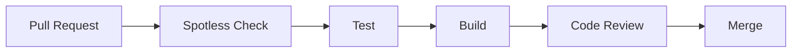

---

## CI/CD & AWS

### AWS 구축 현황

| 영역 | 적용 내용 | 상태 |
| --- | --- | :---: |
| VPC | POP'N UP 전용 VPC | 완료 |
| Subnet | Public / Private Subnet | 완료 |
| NAT Gateway | Private EC2 외부 통신 | 완료 |
| Security Group | ALB → EC2 → RDS / Valkey 접근 제어 | 완료 |
| RDS | MySQL 운영 DB | 완료 |
| Parameter Store | 운영 DB / Redis 설정 관리 | 완료 |
| ECR | Docker Image Repository | 완료 |
| IAM / OIDC | GitHub Actions AWS 인증 | 완료 |
| Launch Template | EC2 실행 환경 관리 | 완료 |
| Auto Scaling Group | EC2 자동 관리 | 완료 |
| Target Group | EC2:8080 연결 | 완료 |
| ALB | 외부 요청 전달 | 완료 |
| Actuator | Health Check | 완료 |
| ElastiCache | Valkey 운영 Redis | 완료 |
| Instance Refresh | 새 Version 자동 교체 | 완료 |
| Auto Scaling Policy | 평균 CPU 30% Target Tracking | 완료 |
| Scale-Out | EC2 1 → 2 실검증 | 완료 |
| Scale-In | EC2 2 → 1 | 완료 |
| Route 53 | 도메인 연결 | 완료 |
| ACM | SSL 인증서 | 완료 |
| HTTPS | ALB 443 / Redirect | 완료 |

---

### CI/CD Pipeline

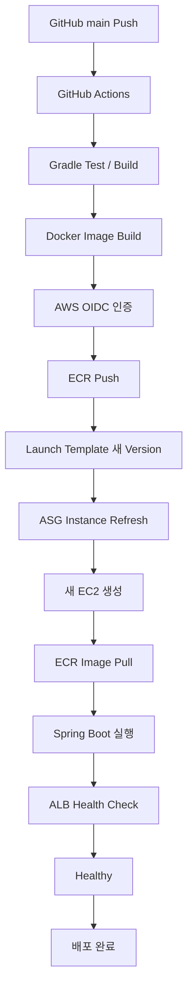

### 배포 방식

GitHub Actions에서 AWS Access Key를 장기간 저장하는 방식 대신 **OIDC 기반 IAM Role 인증**을 사용했습니다.

새로운 Docker Image가 ECR에 Push되면 새로운 Launch Template Version을 생성하고 Auto Scaling Group의 Instance Refresh를 통해 새로운 EC2로 교체하도록 구성했습니다.

---

### Auto Scaling 실검증

Target Tracking Policy의 평균 CPU 목표값을 **30%**로 설정했습니다.

실제 EC2에 CPU 부하를 발생시켜 Scale-Out을 검증했습니다.

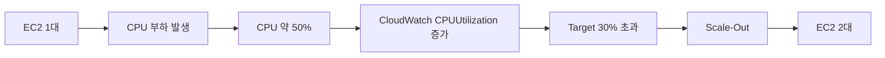

### 결과

> **실제 CPU 부하 발생 후 Auto Scaling Group의 EC2가 1대에서 2대로 증가하는 것을 확인했습니다.**

Scale-Out 설정을 구성하는 데 그치지 않고 실제 CloudWatch Metric과 Scaling Policy가 동작하는 것을 검증했습니다.

---

## 모니터링

부하 테스트와 AWS 운영 검증 과정에서 다음 지표를 확인했습니다.

| 지표 | 활용 목적 |
| --- | --- |
| k6 avg / p95 / p99 | API 응답 지연 분석 |
| k6 Dropped Iterations | 시스템 처리 한계 확인 |
| HikariCP Active / Max | DB Connection Pool 포화 확인 |
| Docker CPU / Memory | Application / MySQL Resource 확인 |
| Actuator Health | Application 및 의존 서비스 상태 확인 |
| CloudWatch CPUUtilization | EC2 부하 및 Auto Scaling 판단 |
| ALB Target Health | Instance 정상 여부 확인 |

### 모니터링을 통해 확인한 내용

- CPU / Memory보다 DB Connection Pool이 먼저 포화되는 현상 확인
- HikariCP `50 / 50` 상태와 HTTP 응답 지연의 관계 확인
- CloudWatch CPUUtilization 증가에 따른 Auto Scaling 동작 확인
- Redis 연결 장애가 Actuator와 ALB Health Check에 미치는 영향 확인

---

## 프로젝트 성과

| 핵심 지표 | 결과 |
| --- | ---: |
| 안정 처리량 측정 | **약 800 req/s** |
| HikariCP 병목 | **50 / 50 포화 확인** |
| 동시 결제 요청 | **2건 → Payment 1건 유지** |
| AWS Scale-Out | **EC2 1 → 2 실검증** |
| 과부하 제어 p95 (1만 명 동시 예약) | **3,095.9 → 1,719.0 ms (44.5% ↓)** |
| 같은 회원 중복 예약 (Redis Lua 좌석 선점) | **11건 → 0건** |
| 목록 조회 p95 (복합 인덱스) | **784.2 → 3.8 ms (206배 빠름)** |
| 캐시 만료 직후 1초 DB 조회 | **2,016건 → 1건** |
| 만료 예약 2만 건 처리 시간 (여러 회차 분산) | **446.2 → 17.7초 (96.0% ↓)** |
| 동시 취소 좌석 중복 반환 | **847건 → 0건** |
| 대기열 순서 역전 (1만 명 · 정원 100) | **51건 → 0건** |

---

## 프로젝트 구조

```text
src/main/java/com/popnup
├── PopnupApplication.java
│
└── popnupbackend
    ├── domain
    │   ├── admin
    │   ├── auth
    │   ├── member
    │   ├── payment
    │   ├── popup
    │   ├── qrcode
    │   ├── reservation
    │   └── schedule
    │
    └── global
        ├── common
        ├── config
        ├── crawler
        ├── entity
        ├── error
        ├── health
        └── security

src/main/resources
├── application.yaml
├── application-local.yaml
├── application-prod.yaml
└── application-test.yaml

.github/workflows
├── ci.yml
├── cicd.yml
└── notification.yml

Dockerfile
docker-compose.yaml
build.gradle
api-test.http
```

---

## 향후 개선

현재 완료된 기능과 아직 검증이 필요한 항목을 구분하여 관리하고 있습니다.

### 성능

- [x] Redis 사전 필터링 적용 후 성능 재측정 → 트러블 슈팅 6
- [ ] Redis 적용 전/후 HikariCP Connection 비교
- [x] Redis 적용 전/후 p95 / p99 비교 → 트러블 슈팅 6
- [x] 조회 성능 Before / After 정량 측정 → 트러블 슈팅 7
- [x] 조회 캐싱 대상 선정 (일정 목록) → 트러블 슈팅 8
- [ ] 캐시 TTL 정책 검증 (지금은 3초 하나만 측정)
- [x] 캐시 적용 전/후 성능 비교 → 트러블 슈팅 8
- [ ] 만료 배치 중 예약 API p99 증가 완화 (여러 회차 분산 34.2 → 89.0 ms) → 트러블 슈팅 9
- [ ] 한 인기 회차에 몰린 만료 처리의 다중 워커 확장 (워커 2 → 4에서 5.9 → 6.0초) → 트러블 슈팅 9
- [ ] 대기열 진입 응답 시간 단축 (진입 응답 p95 2,289.7 ms) → 트러블 슈팅 11

### 모니터링

- [ ] 구조화 로그 정책 보강
- [ ] 로그 레벨 정책 정의
- [ ] 장애 / 이상 상황 감지 체계 보강

### AWS

- [ ] Auto Scaling Scale-In `2 → 1` 최종 검증
- [ ] Route 53 도메인 연결
- [ ] ACM SSL 인증서 적용
- [ ] ALB HTTPS 443 적용
- [ ] HTTP → HTTPS Redirect

---

## 협업 방식

- GitHub Issue 기반 작업 관리
- Feature Branch 기반 개발
- Pull Request를 통한 Code Review
- Branch Protection 적용
- PR Template / Issue Template 사용
- GitHub Actions 기반 CI
- Slack / Discord Workflow 알림

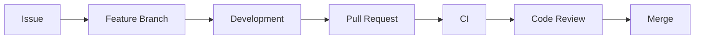

---

<div align="center">

### POP'N UP

**Explore · Reserve · Pay · Check-in**

</div>
